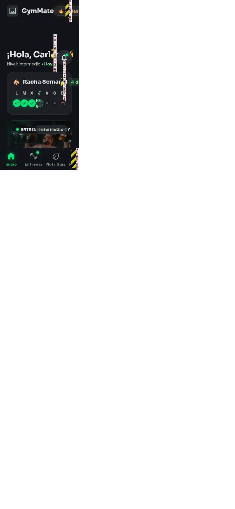

# GymMate

Aplicación móvil para organizar entrenamientos, conservar el progreso y aprender
conceptos básicos de alimentación sin perder los datos cuando no hay conexión.



## Equipo

- Vanessa Ospina
- Salome Caicedo

Programación Móvil (IF2004), grupo 601.

## Requisitos

- Flutter **3.47.7 stable**
- Dart **3.13.5**
- Chrome, Android o iOS para ejecutar la app (navegador, emulador o dispositivo
  real).

La restricción de Dart del proyecto es `^3.13.0`. El proyecto se valida con las
versiones exactas indicadas arriba.

## Ejecutar

```sh
flutter pub get
flutter run
```

Sin configuración Firebase, GymMate abre en modo local de demostración:

- Correo: `demo@gymmate.app`
- Contraseña: `GymMate2026`

El modo de demostración guarda los planes, sesiones, perfil y preferencias en el
dispositivo; no autentica contra la nube. Para usar cuentas Firebase y
sincronización en la nube, configura el proyecto Firebase y ejecuta:

```sh
flutter run --dart-define-from-file=firebase.local.json
```

La app también puede instalarse en un dispositivo conectado con
`flutter run -d <device-id>`. Usa `flutter devices` para consultar los destinos
disponibles.

Para ejecutarla en Chrome:

```sh
flutter run -d chrome
```

La app usa SQLite en el navegador mediante WebAssembly; los archivos requeridos
(`web/sqlite3.wasm` y `web/sqflite_sw.js`) ya están incluidos en el proyecto.
Los datos web se guardan en IndexedDB del navegador.

## Configuración de Firebase

Firebase es opcional para ejecutar el modo de demostración, pero necesario para
registro/inicio de sesión real y sincronización remota.

1. Crea un proyecto en [Firebase Console](https://console.firebase.google.com/).
2. Registra la app Android con el identificador `com.example.proyecto_pm` y,
   si aplica, registra también las apps iOS/Web.
3. En **Authentication → Sign-in method**, habilita **Correo electrónico y
   contraseña**.
4. Crea Firestore y publica [`firestore.rules`](firestore.rules) en sus reglas.
   Activa Firebase Storage, crea el bucket y publica
   [`storage.rules`](storage.rules) en las reglas de Storage.
5. Copia [`.env.example`](.env.example) a `firebase.local.json` y completa los
   valores de configuración de cliente que aparecen en la configuración de cada
   app Firebase: `FIREBASE_API_KEY`, `FIREBASE_PROJECT_ID`,
   `FIREBASE_MESSAGING_SENDER_ID` y el `FIREBASE_*_APP_ID` de cada plataforma.
   El `FIREBASE_STORAGE_BUCKET` aparece en Storage → Files → nombre del bucket
   y se necesita para subir fotos. `FIREBASE_AUTH_DOMAIN` es opcional.
6. Ejecuta con `--dart-define-from-file=firebase.local.json`.

**Importante:** Firebase Storage requiere que el proyecto esté en el plan
Blaze (pago por uso). Revisa las condiciones y posibles cargos de
[Firebase Storage](https://firebase.google.com/docs/storage/flutter/start)
antes de activarlo. La app sigue funcionando en modo demo local sin Storage.

Los valores de configuración de cliente no son claves de cuenta de servicio.
**Nunca** agregues al repositorio `firebase.local.json`, claves privadas de
cuenta de servicio ni credenciales de Firebase Admin. Los archivos nativos
`google-services.json` y `GoogleService-Info.plist` no se usan en esta
configuración y están ignorados por Git. En el repositorio solo se conserva el
archivo de ejemplo sin valores.

Al usar Firebase, cada cuenta crea su perfil de autenticación y solo puede leer
y escribir documentos bajo `users/{uid}`. Las reglas de Firestore limitan las
colecciones a planes y sesiones pertenecientes al usuario autenticado.
Las reglas de Storage limitan cada foto a su propietario autenticado y a un
máximo de 5 MB. No publiques reglas abiertas.

## Funcionalidad y datos

- **Acceso:** Firebase Authentication con la configuración del equipo. Si no
  existe esa configuración, se habilita explícitamente el usuario de demo
  anterior; no se guardan contraseñas en SQLite.
- **Almacenamiento local:** SQLite guarda planes, sesiones con sus series,
  preferencias del perfil, hidratación, selección del plato y respuestas
  recientes de la API. Los registros se filtran por identificador de usuario.
- **Nube:** Firestore conserva planes y sesiones asociados al `uid`. La app
  guarda primero en SQLite, muestra si la sincronización queda pendiente y
  vuelve a intentar al abrir una sesión autenticada.
- **Foto de perfil:** se puede elegir una imagen desde la galería. Se conserva
  localmente y, cuando Firebase Storage está configurado, se sube a
  `users/{uid}/profile/avatar.jpg`. Sin Storage activo, el resto de la app sigue
  funcionando en modo demo y la foto queda en el dispositivo.
- **Notificaciones:** desde Perfil se puede enviar una notificación local de
  prueba; Android/iOS solicitan permiso al usuario. No se envían notificaciones
  push remotas.
- **API:** NutriGuía consulta el catálogo abierto de
  [Open Food Facts](https://world.openfoodfacts.org/). La búsqueda tiene un
  timeout de 8 segundos y sus resultados se guardan en la caché local para
  consultarlos sin conexión.
- **Sin conexión:** se pueden consultar los datos locales, registrar sesiones,
  crear planes y cambiar preferencias. Crear una cuenta o iniciar sesión por
  primera vez necesita acceso a Firebase; las búsquedas nuevas necesitan
  internet, salvo que exista una respuesta guardada para esa consulta.

Los alimentos y rutinas preincluidos son contenido educativo de ejemplo. La
NutriGuía no diagnostica ni reemplaza la orientación profesional.

Según el acuerdo pedagógico adjunto, la integración de IA corresponde a la
semana 17; esta entrega de semana 16 no incluye un modelo generativo ni envía
datos del usuario a un proveedor de IA.

## Preparar una versión firmada para Android

No se incluye ni se genera una llave de firma del equipo. Para firmar una
versión de distribución, crea una llave privada fuera del control de versiones:

```powershell
keytool -genkey -v -keystore android\gymmate-upload.jks -keyalg RSA -keysize 2048 -validity 10000 -alias gymmate
Copy-Item android\key.properties.example android\key.properties
```

Completa `android\key.properties` con la ruta `gymmate-upload.jks`, el alias y
las contraseñas elegidas; conserva ambos archivos privados fuera de Git y haz
una copia de seguridad segura de la llave. Después compila con
`flutter build apk --release`. Sin esos archivos, Gradle no firma el APK de
release; el APK debug sí se puede usar para pruebas locales.

## Arquitectura

- `lib/screens/` y `lib/widgets/`: presentación y componentes.
- `lib/models/`: entidades y modelos de datos.
- `lib/data/local/`: esquema y acceso SQLite.
- `lib/data/remote/`: Firebase y Firestore.
- `lib/data/repositories/`: autenticación, entrenamientos y API con fuentes
  intercambiables.

## Comandos de validación

```sh
flutter analyze
flutter test
```

## Documentación del proyecto

- [Definición final, requisitos y mapa de almacenamiento](docs/definicion.md)
- [Mockups](docs/mockup/)
- [Presentación para sustentación](docs/presentacion/index.html)

La matriz de aportes en la sección 16 de la definición debe completarse con los
commits y Pull Requests reales de cada integrante antes de la entrega.
