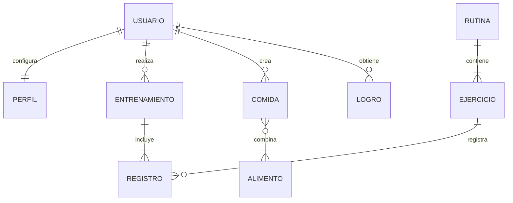
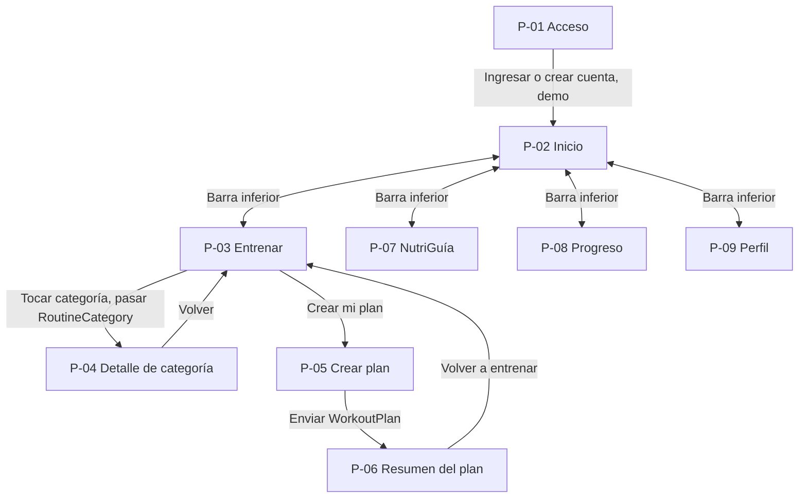
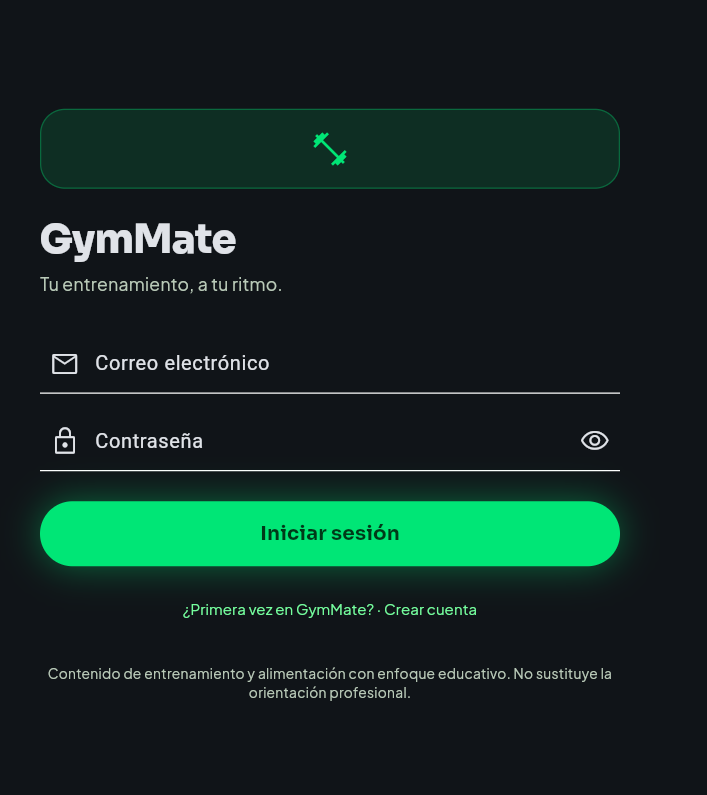
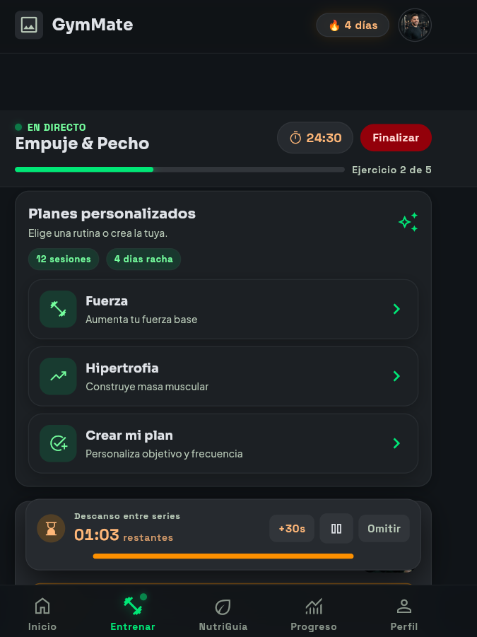
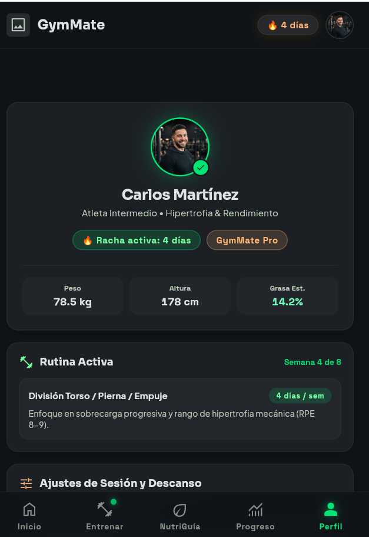

# GymMate

| Ficha | Información |
|---|---|
| Integrantes | Vanessa Ospina, Salome Caicedo |
| Curso y grupo | Programación Móvil (IF2004), grupo 601 |
| Actualización | 20 de noviembre de 2026 |
| Versión | 2.0 |

## Tabla de contenido

1. [Descripción general](#1-descripción-general)
2. [Problema](#2-problema)
3. [Objetivos](#3-objetivos)
4. [Stakeholders, actores y roles](#4-stakeholders-actores-y-roles)
5. [Alcance](#5-alcance)
6. [Funcionalidades](#6-funcionalidades)
7. [Requerimientos funcionales](#7-requerimientos-funcionales)
8. [Requerimientos no funcionales](#8-requerimientos-no-funcionales)
9. [Reglas de negocio](#9-reglas-de-negocio)
10. [Modelo de datos](#10-modelo-de-datos)
11. [Pantallas y mapa de navegación](#11-pantallas-y-mapa-de-navegación)
12. [Mockup](#12-mockup)
13. [Historias, casos de uso, restricciones y supuestos](#13-historias-casos-de-uso-restricciones-y-supuestos)
14. [Arquitectura técnica y navegación implementada](#14-arquitectura-técnica-y-navegación-implementada)
15. [Almacenamiento: nube y local](#15-almacenamiento-nube-y-local)
16. [Aportes por integrante](#16-aportes-por-integrante)

## 1. Descripción general

GymMate es una aplicación móvil de acompañamiento para organizar rutinas, consultar ejercicios, registrar sesiones y revisar el progreso. También ofrece NutriGuía, un espacio educativo con conceptos básicos de alimentación e ideas para combinar alimentos. Está dirigida a personas principiantes e intermedias; la información no reemplaza la orientación de profesionales de entrenamiento, nutrición o salud.

## 2. Problema

Quienes empiezan a entrenar suelen tener dificultades para elegir ejercicios, organizar series y descansos y llevar un registro que permita reconocer sus avances. También encuentran información contradictoria sobre alimentación. GymMate reúne orientación general y seguimiento en el teléfono, disponible durante la sesión de entrenamiento y sin depender de una hoja de cálculo o de consultar varias fuentes. El proyecto no cuenta todavía con una medición de campo de la frecuencia de estos problemas; se validará con pruebas de usuario.

## 3. Objetivos

### 3.1 Objetivo general

Desarrollar una aplicación móvil que permita organizar y realizar entrenamientos, consultar el progreso y aprender conceptos básicos sobre alimentación.

### 3.2 Objetivos específicos

- Al menos el 80 % de participantes de una prueba podrá iniciar una rutina sin ayuda.
- Al menos el 80 % de participantes registrará correctamente una serie en una sesión de prueba.
- Una persona podrá encontrar un ejercicio en menos de 30 segundos usando la lista disponible.
- Al menos el 80 % de participantes identificará cómo construir una comida desde NutriGuía.
- Las personas podrán reconocer en Progreso su historial y al menos una estadística de entrenamiento.

## 4. Stakeholders, actores y roles

| Interesado o rol | Interés y permisos |
|---|---|
| Usuario (rol de la app) | Se registra, inicia sesión, configura su perfil, consulta rutinas y contenidos, registra sus sesiones y revisa sus propios datos. |
| Entrenadores (stakeholder) | Pueden aportar retroalimentación; no tienen un rol operativo en el MVP. |
| Profesionales de nutrición (stakeholder) | Pueden revisar el enfoque educativo; no prescriben dietas desde la app. |
| Equipo desarrollador | Diseña, implementa, prueba y mantiene la aplicación. |
| Universidad y docentes | Evalúan el proyecto académico y su sustentación. |

El MVP contempla un único rol de aplicación: Usuario. El login permite alternar entre iniciar sesión y crear cuenta; en este entregable la entrada es demostrativa y no autentica contra un servidor.

## 5. Alcance

### 5.1 Incluye

- Registro/inicio de sesión y configuración básica de perfil.
- Rutinas, ejercicios, indicaciones y alternativas por equipo.
- Sesión de entrenamiento con series, repeticiones, peso y temporizador.
- Historial, métricas básicas y logros de constancia.
- NutriGuía: aprendizaje, grupos de alimentos, armado de plato, ideas y mitos.
- Navegación entre Inicio, Entrenar, NutriGuía, Progreso y Perfil.

### 5.2 No incluye

Diagnóstico ni tratamiento médico o nutricional; dietas personalizadas; consultas, chat o red social; compra y pagos; clases en vivo; integración con dispositivos; análisis corporal por cámara; ni recomendaciones avanzadas de inteligencia artificial.

## 6. Funcionalidades

| ID | Rol | Funcionalidad |
|---|---|---|
| F-01 | Usuario | Crear cuenta, iniciar sesión y editar información básica del perfil. |
| F-02 | Usuario | Consultar rutinas y abrir su detalle. |
| F-03 | Usuario | Crear un plan indicando nombre, objetivo y frecuencia semanal. |
| F-04 | Usuario | Iniciar una sesión, registrar series y usar el temporizador de descanso. |
| F-05 | Usuario | Consultar historial, estadísticas y logros. |
| F-06 | Usuario | Consultar contenido educativo y construir una idea de comida en NutriGuía. |

## 7. Requerimientos funcionales

| ID | Requerimiento | Rol | Prioridad | Estado y razón |
|---|---|---|---|---|
| RF-01 | Crear una cuenta e iniciar sesión con correo y contraseña. | Usuario | Alta | **Modificado:** Firebase Authentication lo realiza cuando se configura el proyecto; sin esa configuración solo se ofrece la cuenta local de demostración, sin almacenar contraseñas. |
| RF-02 | Consultar y actualizar nivel, objetivos y preferencias del perfil. | Usuario | Media | **Implementado:** nombre, nivel, objetivo, descanso, alertas y unidad se guardan por `uid` en SQLite. |
| RF-03 | Mostrar rutinas y el detalle de la categoría seleccionada. | Usuario | Alta | **Implementado:** contenido base incluido en la app, disponible sin conexión. |
| RF-04 | Crear un plan con nombre de al menos 3 caracteres, objetivo y frecuencia de 2 a 5 días por semana. | Usuario | Alta | **Implementado:** formulario validado; guarda en SQLite e intenta sincronizar el plan con Firestore. |
| RF-05 | Registrar series, repeticiones y peso durante una sesión. | Usuario | Alta | **Modificado:** las series del ejercicio activo se guardan con la sesión localmente y se sincronizan; la sesión actual ofrece un ejercicio a la vez. |
| RF-06 | Mostrar temporizador de sesión y controlar el descanso entre series. | Usuario | Media | **Implementado:** temporizador de sesión y controles de descanso disponibles en Entrenar. |
| RF-07 | Presentar historial, estadísticas básicas y logros de entrenamiento. | Usuario | Media | **Implementado:** volumen, sesiones, series, récords, insignias e historial se derivan de sesiones guardadas. |
| RF-08 | Presentar educación alimentaria y permitir seleccionar alimentos para armar un plato. | Usuario | Alta | **Implementado:** plato educativo con alimentos locales; el catálogo Open Food Facts se consulta aparte y su última respuesta se conserva en caché. |

## 8. Requerimientos no funcionales

| ID | Categoría | Requerimiento verificable | Estado y razón |
|---|---|---|---|
| RNF-01 | Plataforma | La aplicación compila y se ejecuta en las plataformas móviles configuradas. | **Modificado:** Android se valida en este entorno Windows; iOS requiere compilación y prueba desde macOS/Xcode antes de declararlo verificado. |
| RNF-02 | Usabilidad | El formulario de plan impide continuar mientras falte nombre, objetivo o frecuencia e indica el campo. | **Implementado:** validación de formulario y pruebas de widget. |
| RNF-03 | Navegación | Toda pantalla secundaria permite volver con el sistema o una acción visible. | **Implementado:** `Navigator` de Flutter y acciones visibles. |
| RNF-04 | Privacidad | Los datos de perfil y entrenamiento pertenecen a la cuenta; no se guardan contraseñas localmente. | **Modificado:** SQLite particiona registros por `uid`; Firestore aplica reglas por dueño; el usuario local de demo es solo para datos de prueba. |
| RNF-05 | Educación | NutriGuía identifica contenidos como educativos y no médicos. | **Implementado:** aviso educativo y no sustitutivo de profesionales. |
| RNF-06 | Mantenibilidad | La aplicación separa presentación, modelos, repositorios y fuentes de datos. | **Implementado:** `screens/widgets`, `models`, `data/local`, `data/remote` y `data/repositories`. |
| RNF-07 | Conectividad | La aplicación conserva datos operativos sin conexión y muestra errores de API/sincronización. | **Implementado:** SQLite, caché de Open Food Facts, cola local de sincronización y mensajes de estado. |

## 9. Reglas de negocio

| ID | Regla |
|---|---|
| RN-01 | Para usar las funciones principales, la persona debe iniciar sesión y completar un perfil básico. |
| RN-02 | Una rutina debe contener al menos un ejercicio. |
| RN-03 | Todo entrenamiento y registro pertenece a un único usuario. |
| RN-04 | El usuario solo puede modificar sus propios registros. |
| RN-05 | Un entrenamiento finalizado se conserva en el historial. |
| RN-06 | Una alternativa de ejercicio debe considerar el equipo disponible. |
| RN-07 | Los contenidos de NutriGuía son generales y no constituyen diagnóstico, tratamiento ni prescripción. |
| RN-08 | Una comida puede combinar alimentos de distintos grupos seleccionados por el usuario. |

## 10. Modelo de datos

La implementación conserva datos de usuario en SQLite y sincroniza planes y sesiones con Firestore cuando hay configuración y conexión. Rutinas y opciones de alimentos iniciales se distribuyen como contenido de solo lectura. Los resultados consultados en la API se guardan en la caché local.

| Entidad | Atributos principales | Relaciones | Almacenamiento y operación sin conexión |
|---|---|---|
| Usuario | `uid`, correo | Identifica perfil, planes y sesiones. | Firebase Authentication cuando está configurado. La demo usa `local-demo`; no guarda contraseñas. |
| Perfil | `uid`, nombre, nivel, objetivo, unidad y alertas | Pertenece a un usuario. | SQLite, particionado por `uid`; disponible sin conexión. |
| Rutina | id, nombre, descripción | Agrupa ejercicios. | Contenido local de solo lectura en `lib/data/mock_data.dart`. |
| Ejercicio | id, nombre, grupo muscular, equipo, instrucciones | Pertenece a contenido de rutina. | Contenido local de solo lectura. |
| Plan | id, `owner_id`, nombre, objetivo, días, fecha | Pertenece a un usuario. | SQLite primero; sincronización a `users/{uid}/plans` en Firestore cuando está disponible. Queda en SQLite si falla la nube. |
| Sesión | id, `owner_id`, título, duración, fecha, volumen y series | Contiene registros de series. | SQLite primero; sincronización a `users/{uid}/sessions` en Firestore. Se reintenta al abrir la siguiente sesión. |
| Registro de serie | ejercicio, número, repeticiones, peso | Pertenece a una sesión. | JSON local asociado a la sesión; viaja con ella a Firestore. |
| Alimento | nombre, marca y valores por 100 g | Resultado del catálogo. | Open Food Facts; la respuesta de cada consulta se conserva en `api_cache` SQLite. El catálogo base sigue disponible sin red. |
| Plato | selección por grupo de alimentos | Combina alimentos educativos. | Selección local por `uid`; los alimentos base vienen con la app. |
| Logro | condición por número de sesiones | Derivado de sesiones del usuario. | Calculado a partir del historial local, disponible sin conexión. |

## 11. Pantallas y mapa de navegación

| ID | Pantalla | Archivo | Propósito y requerimientos |
|---|---|---|---|
| P-01 | Acceso / crear cuenta | `lib/screens/login_screen.dart` | Firebase Authentication o acceso local de demostración; RF-01. |
| P-02 | Inicio | `lib/screens/inicio_screen.dart` | Resumen y accesos principales; F-01, F-06. |
| P-03 | Entrenar | `lib/screens/entrenar_screen.dart` | Rutinas, sesión activa, series y descanso; RF-03, RF-05, RF-06. |
| P-04 | Detalle de categoría | `lib/screens/category_detail_screen.dart` | Muestra la categoría seleccionada; recibe `RoutineCategory`; RF-03. |
| P-05 | Crear plan | `lib/screens/plan_form_screen.dart` | Captura y valida nombre, objetivo y frecuencia; RF-04. |
| P-06 | Resumen del plan | `lib/screens/plan_summary_screen.dart` | Muestra el `WorkoutPlan` enviado por el formulario; RF-04. |
| P-07 | NutriGuía | `lib/screens/nutriguia_screen.dart` | Aprendizaje, plato y mitos; RF-08. |
| P-08 | Progreso | `lib/screens/progreso_screen.dart` | Historial, estadísticas y logros; RF-07. |
| P-09 | Perfil | `lib/screens/perfil_screen.dart` | Datos y preferencias del usuario; RF-02. |

## 12. Mockup

Las imágenes de `docs/mockup/` corresponden a capturas del prototipo Flutter actual y sirven como mockup de baja fidelidad; se actualizarán si cambia la interfaz. Cada imagen conserva el ID de la pantalla de la sección 11.

| Pantalla | Imagen | Descripción |
|---|---|---|
| P-01 Acceso |  | Marca, correo, contraseña y acción de acceso/registro. |
| P-02 Inicio |  | Resumen personal, racha, rutina y accesos de GymMate. |
| P-03 Entrenar |  | Sesión activa, rutina y control de series/descanso. |
| P-04 Detalle de categoría |  | Detalle de la categoría seleccionada desde Entrenar. |
| P-05 Crear plan |  | Formulario de nombre, objetivo y frecuencia. |
| P-06 Resumen del plan |  | Objetivo y frecuencia recibidos del formulario. |
| P-07 NutriGuía |  | Herramienta para armar un plato y contenidos educativos. |
| P-08 Progreso |  | Métricas, evolución e historial de entrenamiento. |
| P-09 Perfil |  | Perfil, rutina activa y preferencias. |

## 13. Historias, casos de uso, restricciones y supuestos

| ID | Historia de usuario |
|---|---|
| HU-01 | Como usuario nuevo, quiero crear una cuenta para tener un perfil personal. |
| HU-02 | Como usuario, quiero elegir mis objetivos y nivel para orientar mi experiencia. |
| HU-03 | Como usuario, quiero consultar una rutina y su categoría para saber qué entrenar. |
| HU-04 | Como usuario, quiero crear un plan con frecuencia y objetivo para organizar mi semana. |
| HU-05 | Como usuario, quiero registrar series y descansos para conservar el resultado de mi sesión. |
| HU-06 | Como usuario, quiero revisar mi progreso para reconocer mi evolución. |
| HU-07 | Como usuario, quiero aprender sobre alimentos y combinarlos para construir ideas de comidas. |

### 13.1 Caso de uso: crear un plan

| Elemento | Descripción |
|---|---|
| Actor | Usuario con la app abierta. |
| Precondición | Se encuentra en Entrenar. |
| Flujo principal | Abre Crear mi plan, escribe un nombre, elige objetivo y frecuencia, y toca Ver resumen. La app valida el formulario, construye un `WorkoutPlan` y abre el resumen. |
| Excepción | Si falta un dato o el nombre tiene menos de 3 caracteres, el formulario señala el error y permanece abierto. |
| Resultado | P-06 presenta el plan recibido y permite volver a Entrenar. |

### 13.2 Restricciones y supuestos

- La app se desarrolla en Flutter para el proyecto académico y el tiempo disponible es de 3 a 4 meses.
- El contenido inicial de rutinas, ejercicios y alimentos es de demostración.
- El modo local de demostración solo acepta las credenciales de prueba del README y no autentica ni sincroniza con la nube.
- Para cuentas reales, el equipo configura Firebase Authentication, Firestore y las reglas de `firestore.rules`; no se suben archivos locales de configuración ni credenciales privadas.
- La búsqueda nueva en Open Food Facts y el primer inicio de sesión/registro requieren conexión; las búsquedas ya almacenadas, planes, sesiones y preferencias pueden consultarse sin ella.
- La foto de perfil se puede seleccionar desde la galería, queda en almacenamiento local y se sube a Firebase Storage cuando el equipo configura el bucket. `storage.rules` restringe lectura y escritura al `uid` autenticado y limita imágenes a 5 MB.
- Perfil incluye una notificación local de prueba en Android/iOS, con solicitud del permiso del sistema. No se implementa mensajería push remota.
- La app usa recomendaciones por reglas y contenido educativo; no afirma integrar un servicio de inteligencia artificial generativa.

## 14. Arquitectura técnica y navegación implementada

### 14.1 Entorno y organización

Entorno verificado en desarrollo: Flutter 3.47.7 stable y Dart 3.13.5; el constraint del proyecto es `sdk: ^3.13.0`. Versiones resueltas en `pubspec.lock`:

| Paquete | Versión | Uso |
|---|---|---|
| `firebase_core` | 5.2.0 | Inicialización Firebase con opciones privadas del entorno local. |
| `firebase_auth` | 7.1.0 | Registro e inicio de sesión por correo y contraseña. |
| `cloud_firestore` | 7.2.0 | Sincronización de planes y sesiones bajo el `uid`. |
| `firebase_storage` | 14.1.0 | Subida y lectura de la foto de perfil del usuario. |
| `image_picker` | 1.2.4 | Selección de una foto desde la galería. |
| `flutter_local_notifications` | 22.3.3 | Notificación de prueba en Android/iOS. |
| `path_provider` | 2.1.6 | Conservación local de la foto en el directorio de soporte de la app. |
| `sqflite` | 2.4.6 | Base de datos SQLite para datos locales y modo sin conexión. |
| `http` | 1.6.0 | Cliente de Open Food Facts con timeout. |
| `google_fonts` | 8.2.1 | Tipografías del tema existente. |
| `material_symbols_icons` | 4.2960.0 | Iconos Material Symbols. |
| `sqflite_common_ffi` | 2.4.7 (desarrollo) | SQLite en memoria para pruebas de repositorios. |

Flutter provee Material y `Navigator`, por lo que no se requiere un paquete de navegación adicional. La app aplica separación por responsabilidades y Repository Pattern; las pantallas mantienen su estado local con `StatefulWidget` y llaman a repositorios tipados.

| Carpeta | Responsabilidad actual |
|---|---|
| `lib/screens/`, `lib/widgets/` | Presentación, formularios, navegación y estado de cada vista. |
| `lib/models/` | Entidades y modelos serializables de planes y sesiones. |
| `lib/data/local/` | Esquema SQLite y fuente local intercambiable del repositorio. |
| `lib/data/remote/` | Firebase Authentication, configuración, Firestore y Storage. |
| `lib/data/repositories/` | Repositorios de autenticación, entrenamientos, fotos, notificaciones y catálogo API. |
| `lib/data/mock_data.dart` | Rutinas, ejercicios y opciones educativas iniciales. |
| `lib/theme/` | Colores y estilos tipográficos. |

No hay una capa separada de casos de uso/domain ni un `ViewModel` por pantalla; se mantiene una arquitectura de tres responsabilidades adecuada al tamaño actual, sin afirmar una Clean Architecture completa.

### 14.2 Rutas implementadas

| Pantalla | Archivo | Se llega desde | Dato recibido |
|---|---|---|---|
| P-01 Acceso | `lib/screens/login_screen.dart` | Inicio de la aplicación o cierre de sesión | Credenciales Firebase o cuenta local de demo. |
| P-02 Inicio | `lib/screens/inicio_screen.dart` | P-01, al autenticar | Preferencias de hidratación de la cuenta. |
| P-03 Entrenar | `lib/screens/entrenar_screen.dart` | Barra inferior de AppShell | `onTabSelected`. |
| P-04 Detalle de categoría | `lib/screens/category_detail_screen.dart` | P-03, mediante `Navigator.push` | `RoutineCategory` de la categoría tocada. |
| P-05 Crear plan | `lib/screens/plan_form_screen.dart` | P-03, mediante `Navigator.push` | Ninguno. |
| P-06 Resumen del plan | `lib/screens/plan_summary_screen.dart` | P-05, mediante `Navigator.push` | `WorkoutPlan` construido y validado. |
| P-07 NutriGuía | `lib/screens/nutriguia_screen.dart` | Barra inferior de AppShell | Repositorio API, caché y preferencias de plato. |
| P-08 Progreso | `lib/screens/progreso_screen.dart` | Barra inferior de AppShell | Sesiones locales del usuario. |
| P-09 Perfil | `lib/screens/perfil_screen.dart` | Barra inferior de AppShell | Identidad, preferencias y acción de cierre de sesión. |

Cada vista principal tiene su propio `Scaffold`; `AppShell` conserva encabezado y navegación inferior. SQLite es la fuente local de planes y sesiones; Firestore es opcional e intercambiable mediante `WorkoutCloudDataSource`. Al entrar con Firebase se reintentan escrituras pendientes y se descargan documentos del `uid` autenticado. `NutritionRepository` consulta Open Food Facts, valida la respuesta JSON y usa `api_cache` cuando la red falla. `firestore.rules` exige autenticación y coincidencia de `request.auth.uid` con el dueño de la ruta y del documento.

La app muestra un estado de demostración si no se pasan opciones Firebase por `--dart-define-from-file`. La configuración de un proyecto real y la prueba en un dispositivo/emulador deben completarse antes de la sustentación.

## 15. Almacenamiento: nube y local

| Dato | Nube | Local | Qué ocurre sin conexión |
|---|---|---|---|
| Cuenta y credenciales | Firebase Authentication (con proyecto configurado). | Firebase SDK conserva la sesión; GymMate no persiste la contraseña. | Una sesión autenticada ya iniciada puede abrirse con la sesión almacenada; crear cuenta o iniciar sesión por primera vez requiere conexión. |
| Perfil, objetivos, preferencias e hidratación | No se sincronizan. | SQLite `preferences`, particionado por `owner_id`. | Se consultan y actualizan localmente. |
| Foto de perfil | Firebase Storage `users/{uid}/profile/avatar.jpg`, con reglas de propietario y validación de tipo/tamaño. | Copia en el directorio privado de la app; la ruta se guarda en `preferences`. | La foto local permanece disponible; una nueva carga remota requiere conexión. |
| Notificación de prueba | No aplica. | Notificación local del sistema operativo; no se guarda contenido personal. | El usuario puede enviar la prueba sin conexión si concede permiso al sistema. |
| Planes personalizados | Firestore `users/{uid}/plans`, con reglas de propietario. | SQLite `workout_plans`, marcado como sincronizado o pendiente. | Se pueden crear y consultar; se reintentan al volver a abrir la app con la cuenta autenticada. |
| Sesiones y series | Firestore `users/{uid}/sessions`, con reglas de propietario. | SQLite `workout_sessions`; incluye los detalles JSON de series. | Se pueden guardar y revisar sin red; el intento fallido queda pendiente. |
| Catálogo Open Food Facts | API pública; no se envían datos de cuenta a la API. | SQLite `api_cache`, indexada por término de búsqueda. | Se muestran las últimas respuestas guardadas para el mismo término; una búsqueda nunca guardada presenta un error claro. |
| Rutinas y alimentos educativos iniciales | No aplica. | Datos incluidos en `lib/data/mock_data.dart`. | Siempre disponibles. |
| Selección del plato y logros | No se sincronizan. | Plato en preferencias SQLite; logros calculados desde sesiones locales. | Se mantienen disponibles en el dispositivo. |

Las reglas de Firestore y Storage están en `firestore.rules` y `storage.rules`. No se despliegan desde este repositorio; el equipo debe publicarlas en Firebase Console antes de probar sincronización o subida de fotos.

De acuerdo con el documento pedagógico entregado por el equipo, IA corresponde a la semana 17 y no hace parte del alcance solicitado para la entrega de semana 16. La compilación de distribución necesita una llave privada propia del equipo, excluida del repositorio; el procedimiento está en el README.

## 16. Aportes por integrante

La tabla siguiente se basa solo en autores y commits visibles en el historial del repositorio. Los enlaces permiten contrastar cada aporte con GitHub; la entrega final debe añadir los PR/commits funcionales que el equipo realice para esta versión.

| Integrante | Aportes respaldados por Git | Evidencia |
|---|---|---|
| Vanessa Ospina | Integración de planes personalizados, pruebas de widgets, navegación y mockups. | [de02ba1](https://github.com/Salo140/Proyecto_PM/commit/de02ba1), [d684947](https://github.com/Salo140/Proyecto_PM/commit/d684947), [fbc17f1](https://github.com/Salo140/Proyecto_PM/commit/fbc17f1), [2e4959d](https://github.com/Salo140/Proyecto_PM/commit/2e4959d). |
| Salome Caicedo | Implementación inicial, pantallas principales y presentación del proyecto. | [ca6f8b9](https://github.com/Salo140/Proyecto_PM/commit/ca6f8b9), [84577f4](https://github.com/Salo140/Proyecto_PM/commit/84577f4), [9893379](https://github.com/Salo140/Proyecto_PM/commit/9893379), [d0aa2cb](https://github.com/Salo140/Proyecto_PM/commit/d0aa2cb). |

Estos commits acreditan aportes anteriores del proyecto, no la implementación descrita en esta versión. Los commits asistidos por IA requieren revisión y explicación del equipo; no se atribuyen aquí como trabajo individual de Vanessa o Salome. Antes de entregar, registren en esta tabla los PR y commits nuevos de cada integrante y aseguren que cada persona haya realizado una contribución funcional propia y revisable.

## Historial de cambios

| Fecha | Cambio | Responsable |
|---|---|---|
| 25-09-2026 | Definición formal del entregable 1 y correspondencia inicial con el prototipo. | Equipo GymMate |
| 20-11-2026 | Implementación de SQLite, autenticación/sincronización opcional con Firebase, catálogo API, foto local/Storage, notificación de prueba, métricas reales, pruebas y guía de firma Android. | GitHub Copilot como apoyo; revisión del equipo pendiente. |

## Referencias

| Fuente | Uso en el documento |
|---|---|
| [Actividad: definición del proyecto y navegación](https://oscarleosanchez.github.io/sitio-iue-2026-02/movil/proyecto-entregable-1/actividad/) | Estructura, condiciones mínimas y alcance del entregable 1. |
| [Actividad: proyecto funcionando](https://oscarleosanchez.github.io/sitio-iue-2026-02/movil/proyecto-entregable-final/actividad/) | Requisitos finales de nube/local, API, seguridad, README, aportes y sustentación. |
| [Material del curso: semana 07](https://oscarleosanchez.github.io/sitio-iue-2026-02/movil/semana-07/) | Consumo de datos externos, estados de carga y errores. |
| [Material del curso: semana 12](https://oscarleosanchez.github.io/sitio-iue-2026-02/movil/semana-12/) | MVVM y Repository Pattern. |
| [Material del curso: semana 13](https://oscarleosanchez.github.io/sitio-iue-2026-02/movil/semana-13/) | Separación de fuentes de datos y pruebas con SQLite/local. |
| [Firebase: Authentication](https://firebase.google.com/docs/auth/flutter/start) | Inicio y registro de cuentas. |
| [Firebase: Firestore Security Rules](https://firebase.google.com/docs/firestore/security/get-started) | Restricción de acceso a los datos por `uid`. |
| [Firebase: Storage](https://firebase.google.com/docs/storage/flutter/start) | Subida y consulta de la foto de perfil. |
| [Flutter Local Notifications](https://pub.dev/packages/flutter_local_notifications) | Notificación local de prueba y solicitud de permisos. |
| [Open Food Facts API](https://openfoodfacts.github.io/openfoodfacts-server/api/) | Búsqueda externa de alimentos y nutrimentos. |
| [Flutter: Navigation and routing](https://docs.flutter.dev/ui/navigation) | Navegación entre pantallas con Navigator. |
| [Flutter: Form validation](https://docs.flutter.dev/cookbook/forms/validation) | Validación del formulario del plan. |
| Acuerdo pedagógico IF2004, grupo 601 (documento adjunto por el equipo) | Alcance de las entregas semanales; para esta versión se prioriza el proyecto final de semana 16 y se reserva IA para semana 17. |

## Declaración de uso de inteligencia artificial

Se utilizó GitHub Copilot como apoyo para contrastar el repositorio con la actividad final, implementar componentes de persistencia local, autenticación/sincronización Firebase configurable, consulta API, pruebas y documentación. Las personas integrantes deben revisar y comprender cada cambio y registrar sus propios aportes funcionales en Git; la herramienta no sustituye la sustentación ni la verificación en el Firebase del equipo. Sin configurar Firebase, el proyecto opera explícitamente en modo local de demostración, no en modo de nube.